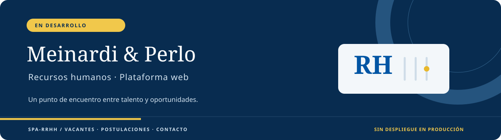
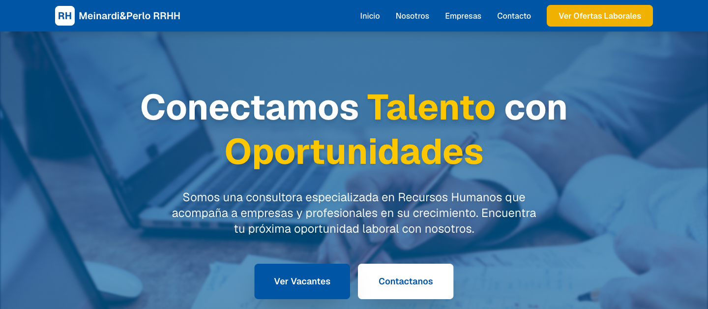
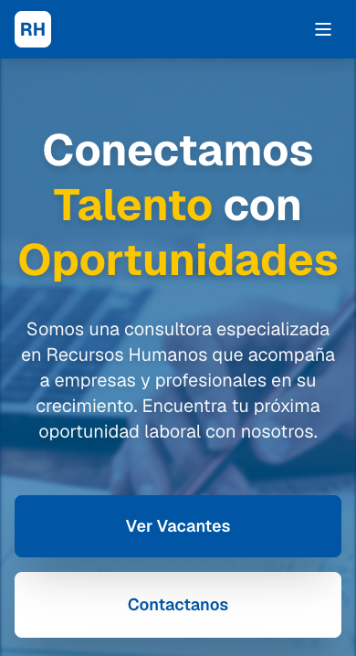
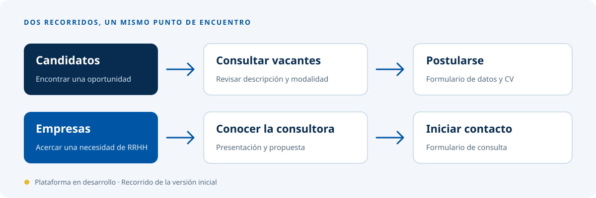

<p align="center"></p>

# spa-rrhh · Meinardi & Perlo RRHH

> **En desarrollo. El proyecto todavía no está desplegado en producción.**

Plataforma web para una consultora de recursos humanos de Las Varillas, Córdoba. Busca conectar candidatos con oportunidades laborales y ofrecer a las empresas un canal para conocer la propuesta e iniciar una consulta.

<p>
  
  
  
  
  
</p>

[El proyecto](#el-proyecto) · [Vista local](#vista-local) · [Alcance](#alcance) · [Decisiones](#decisiones) · [Desarrollo local](#guia-tecnica) · [Evolución en develop](https://github.com/MaxiPerlo15/spa-rrhh/tree/develop)

<a id="el-proyecto"></a>
## El proyecto

El objetivo es reunir la presentación de la consultora y el inicio del proceso de selección dentro de una misma experiencia.

- **Candidatos:** conocer oportunidades, revisar una vacante y completar una postulación.
- **Empresas:** conocer la consultora y enviar una consulta.
- **Equipo de RRHH:** avanzar hacia una gestión centralizada del proceso, actualmente en desarrollo.

<a id="vista-local"></a>
## Vista local de desarrollo

Capturas del entorno local de la versión inicial, con datos de ejemplo.

| Escritorio | Móvil |
| --- | --- |
|  |  |

<a id="alcance"></a>
## Alcance y estado

### Base inicial · `main`

- Landing con presentación institucional y navegación por secciones.
- Listado de vacantes con descripción, ubicación y modalidad.
- Formulario de postulación asociado a una vacante, con datos de contacto y CV.
- Formulario de consultas para empresas y visitantes.
- API Routes de Next.js y persistencia con Prisma y PostgreSQL.



### Evolución en curso · `develop`

La [rama de desarrollo](https://github.com/MaxiPerlo15/spa-rrhh/tree/develop) concentra el trabajo de administración del proceso de selección, autenticación y evolución de los servicios hacia un backend Spring Boot.

La base inicial y esa evolución se mantienen diferenciadas. **Ninguna representa un despliegue en producción.** Para experimentar con la versión inicial, usar únicamente datos ficticios: la protección de los endpoints y el tratamiento de datos personales requieren completarse y validarse antes de un uso real.

<a id="decisiones"></a>
## Decisiones y forma de trabajo

| Decisión | Propósito |
| --- | --- |
| Portal público enfocado | Dar a candidatos y empresas un punto de entrada claro. |
| Postulación vinculada a una vacante | Mantener el contexto de la oportunidad durante el envío del formulario. |
| Componentes React separados | Organizar navegación, presentación, tarjetas y formularios. |
| Modelo relacional | Persistir vacantes, postulaciones y contactos con PostgreSQL. |
| Evolución en una rama de desarrollo | Trabajar en capacidades administrativas y cambios de arquitectura sin confundirlos con la base inicial. |

### Caso de estudio

**Necesidad:** atender dos recorridos, la búsqueda de oportunidades y la consulta de empresas. **Propuesta:** un portal que presenta la consultora, muestra vacantes y facilita el primer contacto. **Desarrollo:** partir de esa experiencia pública y ampliar progresivamente la gestión interna del proceso de selección.

<a id="documentacion"></a>
## Documentación

- [Alcance, arquitectura y guía del proyecto](docs/PROJECT.md).
- [Código de la base inicial](https://github.com/MaxiPerlo15/spa-rrhh/tree/main).
- [Trabajo en desarrollo](https://github.com/MaxiPerlo15/spa-rrhh/tree/develop).

<a id="guia-tecnica"></a>
<details>
<summary>Desarrollo local y stack de la base inicial</summary>

### Stack

Next.js 16 · React 19 · TypeScript 5 · Tailwind CSS 4 · Prisma 7 · PostgreSQL.

### Preparación

Entorno recomendado para la base inicial: Node.js 24 LTS, npm y PostgreSQL 16. Usar una base de desarrollo con datos ficticios.

```bash
npm ci
```

Configurar `DATABASE_URL` en un archivo `.env` local, sin publicar credenciales. Luego:

```bash
npx prisma generate
npx prisma migrate dev
npm run dev
```

La aplicación de esta base se abre en [localhost:3000](http://localhost:3000).

### Comprobaciones disponibles

```bash
npm run lint
npm run build
```

Para servir una compilación local:

```bash
npm run start
```

La base inicial no define scripts de tests. La infraestructura y los comandos de `develop` evolucionan por separado; consultar su documentación al trabajar en esa rama.

</details>
