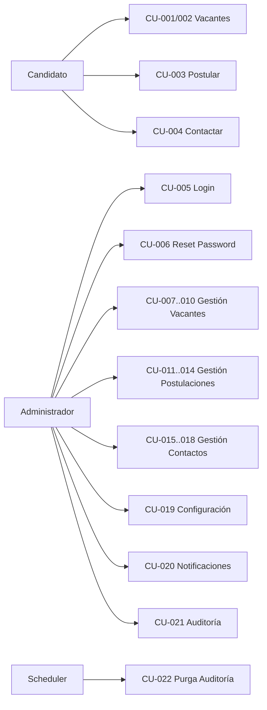

# 05. Catálogo de Casos de Uso (CU)

## 1. Matriz de CU

| ID | Nombre | Actor Principal | Actor Secundario | Objetivo | Categoría |
|---|---|---|---|---|---|
| CU-001 | Consultar vacantes públicas | Candidato | Sistema | Visualizar vacantes activas | Consulta |
| CU-002 | Filtrar vacantes públicas | Candidato | Sistema | Encontrar vacantes relevantes | Consulta |
| CU-003 | Postular a vacante | Candidato | UploadThing, Turnstile, Resend | Registrar candidatura | Transacción |
| CU-004 | Enviar contacto | Candidato | Turnstile, Resend | Registrar consulta comercial | Transacción |
| CU-005 | Iniciar sesión admin | Administrador | NextAuth, Upstash | Obtener sesión válida | Seguridad |
| CU-006 | Recuperar contraseña | Administrador | Resend, Upstash | Restablecer acceso | Seguridad |
| CU-007 | Crear vacante | Administrador | Sistema | Alta de vacante | CRUD-ABCM |
| CU-008 | Consultar vacantes admin | Administrador | Sistema | Visualización operativa | CRUD-ABCM |
| CU-009 | Actualizar vacante | Administrador | Sistema | Modificar vacante | CRUD-ABCM |
| CU-010 | Eliminar vacante | Administrador | Sistema | Baja de vacante | CRUD-ABCM |
| CU-011 | Consultar postulaciones | Administrador | Sistema | Seguimiento de candidatos | CRUD-ABCM |
| CU-012 | Ver detalle postulación | Administrador | Sistema | Inspección de candidatura | CRUD-ABCM |
| CU-013 | Actualizar estado postulación | Administrador | Sistema | Avanzar flujo de selección | CRUD-ABCM |
| CU-014 | Eliminar postulación | Administrador | Sistema | Depurar registro | CRUD-ABCM |
| CU-015 | Consultar contactos | Administrador | Sistema | Gestionar consultas | CRUD-ABCM |
| CU-016 | Ver detalle contacto | Administrador | Sistema | Inspección de consulta | CRUD-ABCM |
| CU-017 | Actualizar estado contacto | Administrador | Sistema | Resolver consulta | CRUD-ABCM |
| CU-018 | Eliminar contacto | Administrador | Sistema | Depurar registro | CRUD-ABCM |
| CU-019 | Configurar preferencias admin | Administrador | Sistema | Ajustar notificaciones | Configuración |
| CU-020 | Gestionar notificaciones | Administrador | Sistema | Leer/marcar/eliminar notificaciones | Proceso automático |
| CU-021 | Consultar auditoría | Administrador | Sistema | Trazabilidad operativa | Reportería/Estadística |
| CU-022 | Ejecutar purga de auditoría | Proceso programado | Sistema | Cumplir retención | Proceso automático |

## 2. Diagrama General de CU

## 3. Clasificación solicitada de CU

### 3.1 Transacción
- CU-003, CU-004

### 3.2 Seguridad
- CU-005, CU-006

### 3.3 Reportería/Estadística
- CU-021

### 3.4 CRUD/ABCM (separados)
- Vacantes: CU-007 (Alta), CU-008 (Consulta), CU-009 (Modificación), CU-010 (Baja)
- Postulaciones: CU-011 (Consulta), CU-012 (Detalle), CU-013 (Modificación), CU-014 (Baja)
- Contactos: CU-015 (Consulta), CU-016 (Detalle), CU-017 (Modificación), CU-018 (Baja)

### 3.5 Procesos automáticos
- CU-020, CU-022
