# 08. Diagrama de Clases (Boundary-Control-Entity)

## 1. Notación utilizada

- `<<boundary>>`: interfaz/adaptador de entrada.
- `<<control>>`: coordinación de casos de uso y reglas.
- `<<entity>>`: entidades de dominio persistidas.
- `<<pure-fabrication>>`: clases de creación pura (servicios técnicos no de dominio).

## 2. Diagrama de clases BCE

```mermaid
classDiagram
  class LandingPage {
    <<boundary>>
  }
  class OffersPage {
    <<boundary>>
  }
  class AdminDashboardPage {
    <<boundary>>
  }

  class VacanciesRoute {
    <<boundary>>
  }
  class ApplicationsRoute {
    <<boundary>>
  }
  class ContactsRoute {
    <<boundary>>
  }
  class AuthRoutes {
    <<boundary>>
  }

  class ApplicationService {
    <<control>>
    +createApplication()
    +validateDuplicate()
  }
  class ContactService {
    <<control>>
    +createContact()
    +validateDuplicate()
  }
  class VacancyService {
    <<control>>
    +createVacancy()
    +updateVacancy()
    +deleteVacancy()
  }
  class AuthService {
    <<control>>
    +authorize()
    +forgotPassword()
    +resetPassword()
  }
  class NotificationService {
    <<control>>
  }
  class AuditService {
    <<control>>
  }

  class User {
    <<entity>>
  }
  class Vacancy {
    <<entity>>
  }
  class Application {
    <<entity>>
  }
  class Contact {
    <<entity>>
  }
  class AdminSettings {
    <<entity>>
  }
  class PasswordResetToken {
    <<entity>>
  }
  class AdminNotification {
    <<entity>>
  }
  class AdminAuditLog {
    <<entity>>
  }

  class PrismaRepository {
    <<pure-fabrication>>
  }
  class RateLimitProvider {
    <<pure-fabrication>>
  }
  class AuthAttemptGuard {
    <<pure-fabrication>>
  }
  class MailProvider {
    <<pure-fabrication>>
  }
  class FileStorageProvider {
    <<pure-fabrication>>
  }
  class BotVerificationProvider {
    <<pure-fabrication>>
  }

  VacanciesRoute --> VacancyService
  ApplicationsRoute --> ApplicationService
  ContactsRoute --> ContactService
  AuthRoutes --> AuthService

  VacancyService --> Vacancy
  ApplicationService --> Application
  ContactService --> Contact
  AuthService --> User
  AuthService --> PasswordResetToken
  NotificationService --> AdminNotification
  AuditService --> AdminAuditLog

  VacancyService --> PrismaRepository
  ApplicationService --> PrismaRepository
  ContactService --> PrismaRepository
  AuthService --> PrismaRepository

  ApplicationService --> RateLimitProvider
  ContactService --> RateLimitProvider
  AuthService --> AuthAttemptGuard
  AuthService --> MailProvider
  ApplicationService --> FileStorageProvider
  ApplicationService --> BotVerificationProvider
```

