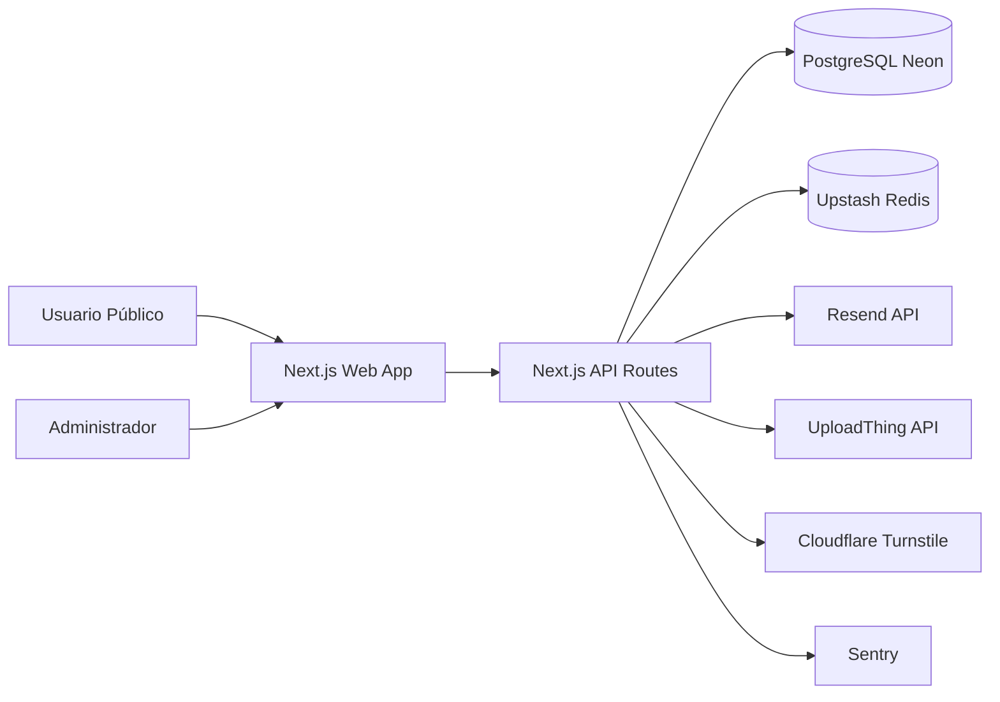
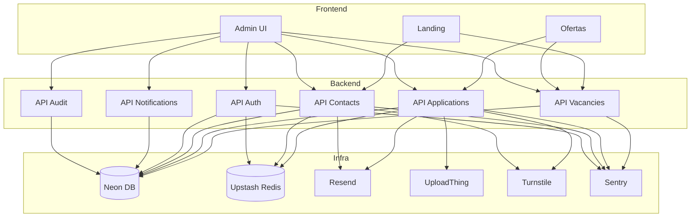
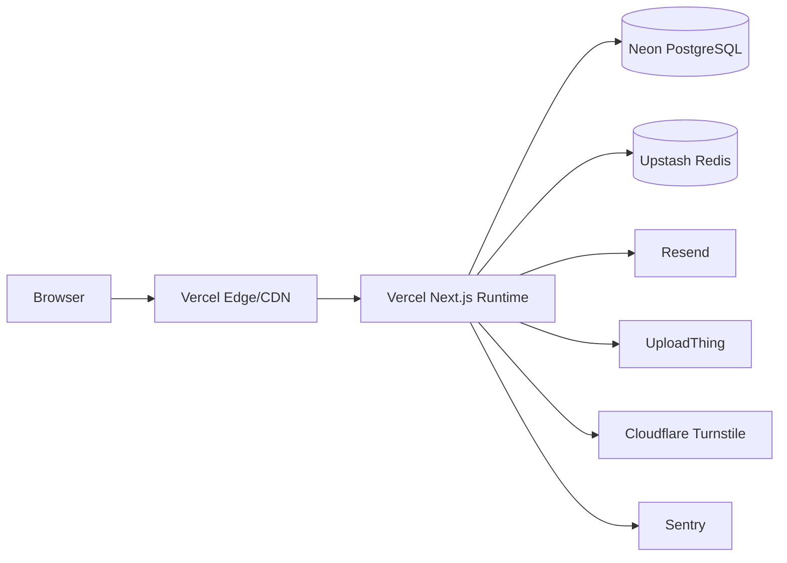

# 11. Vistas Arquitectónicas

## 1. Vista Funcional

- Subsistema público: landing, ofertas, formularios.
- Subsistema admin: autenticación, gestión operativa, auditoría.
- Subsistema transversal: seguridad, anti-abuso, observabilidad.

## 2. Vista Lógica (C4 - Container)

## 3. Vista de Diseño (Componentes internos)

- `src/app` (presentación/rutas)
- `src/components` (UI reusable)
- `src/hooks` (lógica de interacción)
- `src/lib` (servicios, seguridad, validaciones)
- `src/app/api` (adaptadores HTTP)
- `prisma` (modelo de datos y migraciones)

## 4. Vista de Diseño Global

## 5. Vista de Despliegue

