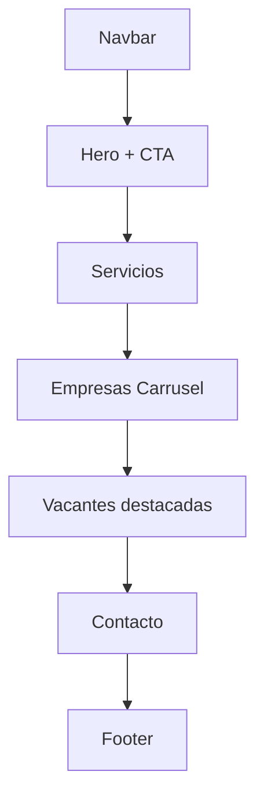
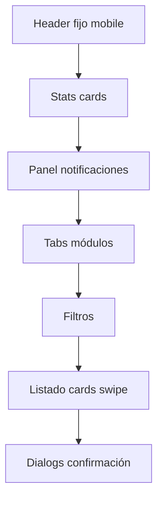
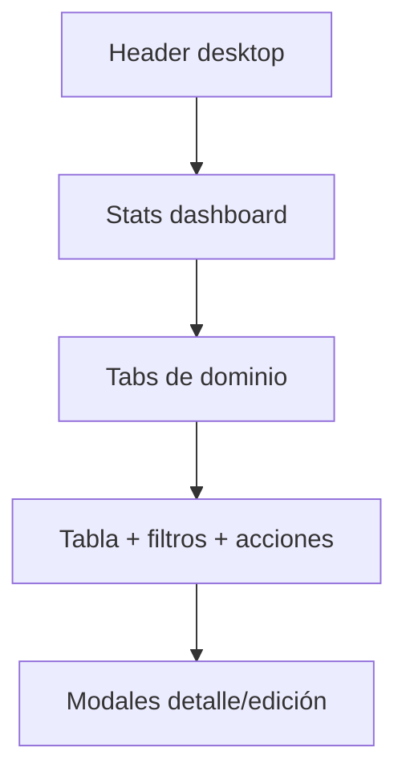

# 14. Prototipos de Interfaz (Wireframes de arquitectura)

## 1. Mapa de navegación

```mermaid
flowchart LR
  HOME[/\//] --> NOS[#nosotros]
  HOME --> SERV[#servicios]
  HOME --> EMP[#empresas]
  HOME --> CONT[#contacto]
  HOME --> OFF[/ofertas-laborales]
  OFF --> POST[Modal Postulación]
  HOME --> SIGNIN[/admin/signin]
  SIGNIN --> ADMIN[/admin]
  ADMIN --> VAC[Tab Vacantes]
  ADMIN --> APP[Tab Postulaciones]
  ADMIN --> CON[Tab Contactos]
  ADMIN --> SET[Tab Configuración]
  SIGNIN --> FORGOT[/admin/forgot-password]
  FORGOT --> RESET[/admin/reset-password]
```

## 2. Prototipo estructural Landing



## 3. Prototipo estructural Admin Mobile



## 4. Prototipo estructural Admin Desktop


